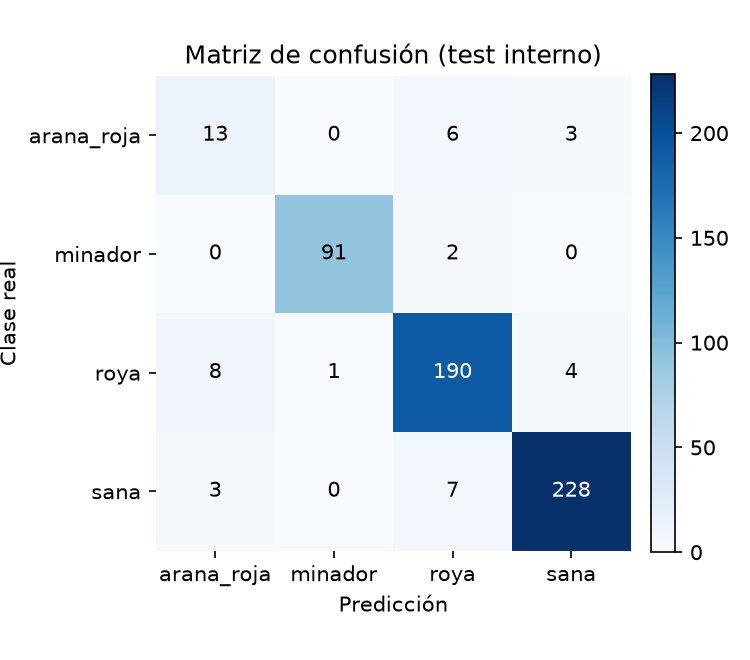

# Resultados

Archivo generado por `ml/generar_resultados.py` a partir de `ml/outputs/`. No editar a mano.

Modelo `v2-2026-10`: efficientnetb0 con clases minador, roya, sana.

## Lo esencial

| Dónde se mide | Qué mide | Imágenes | Exactitud | F1 macro |
|---|---|---|---|---|
| Test interno | Imágenes de las mismas fuentes del entrenamiento | 536 | 0.9907 | 0.9902 |
| Conjunto final (JMuBEN) | Fuente nunca usada para entrenar ni para decidir | 44297 | **0.8003** | **0.7658** |

La cifra que estima el comportamiento con imágenes nuevas es la del conjunto final, no la del test interno.

## Datos

| Fuente y clase | train | val | test |
|---|---|---|---|
| bracol / minador | 177 | 38 | 38 |
| bracol / roya | 326 | 70 | 69 |
| bracol / sana | 100 | 21 | 21 |
| decafia / minador | 261 | 56 | 55 |
| decafia / roya | 238 | 51 | 51 |
| decafia / sana | 499 | 106 | 106 |
| rocole / roya | 398 | 85 | 85 |
| rocole / sana | 522 | 112 | 111 |

Total: 3596 imágenes. Reparto estratificado por fuente y clase; desviación máxima respecto a 70/15/15: 0.0042. Duplicados eliminados: 535. Imágenes en dos particiones: 0 por MD5, 0 pares por hash perceptual y 0 grupos repartidos.

## Entrenamiento del modelo final

Hardware: Tesla T4. Tiempo: 1483.8 s. Épocas ejecutadas: 10 (cabeza) + 23 (ajuste fino). TensorFlow 2.21.0, Keras 3.15.1, Python 3.13.15. Pérdida de validación: 0.6837 en la época 1, mínimo 0.3447.

## Cómo se eligió la arquitectura (etapa 1)

Las dos arquitecturas se entrenaron sin BRACOL y se midieron en BRACOL, una fuente que no habían visto.

| Modelo | BRACOL exactitud | BRACOL F1 macro | Recall minador | Recall roya | Recall sana |
|---|---|---|---|---|---|
| v1 (MobileNetV2) | 0.6872 | 0.626 | 0.4466 | 0.8925 | 0.4437 |
| v2 MobileNetV2 | 0.7767 | 0.7313 | 0.3676 | 0.9419 | 0.9648 |
| v2 EfficientNet-B0 | 0.8581 | 0.8494 | 0.6087 | 0.9613 | 0.9648 |

BRACOL se usó para elegir la arquitectura y el umbral, y después se añadió al entrenamiento del modelo final; por eso sus cifras no son una estimación independiente.

## Test interno (536 imágenes)

Exactitud: 0.9907. F1 macro: 0.9902.

| Clase | Precisión | Recall | F1 | Imágenes |
|---|---|---|---|---|
| minador | 0.9892 | 0.9892 | 0.9892 | 93 |
| roya | 0.995 | 0.9805 | 0.9877 | 205 |
| sana | 0.9876 | 1.0 | 0.9937 | 238 |

Filas: clase real. Columnas: predicción.

|  | minador | roya | sana |
|---|---|---|---|
| minador | 92 | 1 | 0 |
| roya | 1 | 201 | 3 |
| sana | 0 | 0 | 238 |

Por fuente:

| Fuente | Imágenes | Exactitud | F1 macro |
|---|---|---|---|
| bracol | 128 | 0.9844 | 0.9864 |
| decafia | 212 | 1.0 | 1.0 |
| rocole | 196 | 0.9847 | 0.9844 |

## Conjunto final: JMuBEN (44297 imágenes)

JMuBEN and JMuBEN2 (Mendeley t2r6rszp5c and tgv3zb82nd, CC BY 4.0): Leaf rust, Healthy, Miner. Se evaluó una sola vez, con el modelo y el umbral ya confirmados en git.

| Modelo | Exactitud | F1 macro | Recall minador | Recall roya | Recall sana |
|---|---|---|---|---|---|
| v1 | 0.6137 | 0.5895 | 0.3374 | 0.8388 | 0.7619 |
| v2 (final) | 0.8003 | 0.7658 | 0.5458 | 0.8637 | 1.0 |

Detalle del modelo v2:

| Clase | Precisión | Recall | F1 | Imágenes |
|---|---|---|---|---|
| minador | 0.9764 | 0.5458 | 0.7002 | 16978 |
| roya | 0.5011 | 0.8637 | 0.6342 | 8336 |
| sana | 0.9288 | 1.0 | 0.9631 | 18983 |

Filas: clase real. Columnas: predicción.

|  | minador | roya | sana |
|---|---|---|---|
| minador | 9266 | 7168 | 544 |
| roya | 224 | 7200 | 912 |
| sana | 0 | 0 | 18983 |

JMuBEN son recortes de hojas de café arábica tomados en Kenia y ampliados por sus autores con aumento de datos; no son fotos de campo de una hoja completa.

## Umbral de confianza y calibración

Umbral: **0.55**. Origen: stage1_efficientnetb0 (holdout source bracol): lowest threshold with accepted accuracy >= 0.90 on a source unseen in training. La regla aplicada a la validación interna daría 0.4, que lo acepta todo.

En el conjunto final, con ese umbral se acepta el 93.6% de las imágenes, con exactitud 0.8196 sobre las aceptadas.

Error de calibración esperado (15 intervalos): 0.0745 en el test interno y 0.1198 en el conjunto final (confianza media 0.766, exactitud 0.8003).

## Modelo y paridad

| Archivo | Bytes | Entrada | Salida |
|---|---|---|---|
| model_fp32.tflite | 16072468 | [1, 224, 224, 3] float32 | [1, 3] float32 |
| model.tflite | 4572672 | [1, 224, 224, 3] float32 | [1, 3] float32 |

La app lleva `model_fp32.tflite` (copiado a `assets/model.tflite`).

| Comparación (100 imágenes de test) | Coincidencia de clase | Diferencia máx. de probabilidad |
|---|---|---|
| keras vs fp32 | 1.0 | 0.000973 |
| keras vs quantized | 1.0 | 0.136427 |
| fp32 vs quantized | 1.0 | 0.136297 |

## Android (teléfono)

Dispositivo: motorola motorola edge 30, Android 14, arm64-v8a.

- Paridad nivel 1 (modelo aislado): diferencia máxima de probabilidad 0.0000004 (límite 0.01).
- Paridad nivel 2 (flujo completo): 10 de 10 clases coinciden.
- Latencia con 4 hilos (50 medidas): mediana 48.0 ms, p95 48 ms.
- Comparación de hilos: 2 hilos, mediana 48.0 ms y p95 49 ms; 4 hilos, mediana 48.0 ms y p95 49 ms.

## Referencia: modelo v1

MobileNetV2 entrenado con RoCoLe y DECAFIA. Test interno: exactitud 0.9561, F1 macro 0.9587. Ese test estaba sesgado (casi sin imágenes de RoCoLe), así que no es comparable con el test interno de la v2. Archivos en `ml/outputs_v1/`.

## Resultados en campo

NO EJECUTADO. Faltan fotos reales tomadas por el humano en condiciones de campo (fase 12, paso 2). Registrar los casos en `docs/campo.csv` y volver a ejecutar `make results`.

## Limitaciones

- El modelo confunde minador con roya en imágenes nuevas: en el conjunto final reconoce 55% de las hojas con minador y solo 50% de lo que llama roya lo es.
- No hay evaluación con fotos de campo tomadas por el equipo. El conjunto final es de otro país y son recortes, no hojas completas fotografiadas con la app.
- BRACOL se deduplicó solo por coincidencia exacta de archivo; si contiene varias tomas de una misma hoja, puede haber fuga entre particiones que infle el test interno.
- Siguen los riesgos de fuga de la v1: recortes de lesión que pueden provenir de fotos de otra partición y varias tomas de una misma hoja en la clase sana de DECAFIA.
- El modelo solo conoce hojas. Una imagen que no es una hoja recibe igualmente una clase.
- La confianza está mal calibrada fuera de los datos de entrenamiento: el modelo se muestra más seguro de lo que acierta.
- Un solo entrenamiento por configuración y una sola semilla: no se midió la variabilidad.
- Cambio de dominio: RoCoLe es Robusta de Ecuador, BRACOL y parte de DECAFIA son de Brasil; en Colombia predomina el arábica.
- Es un prototipo académico de apoyo, no una herramienta de diagnóstico.
