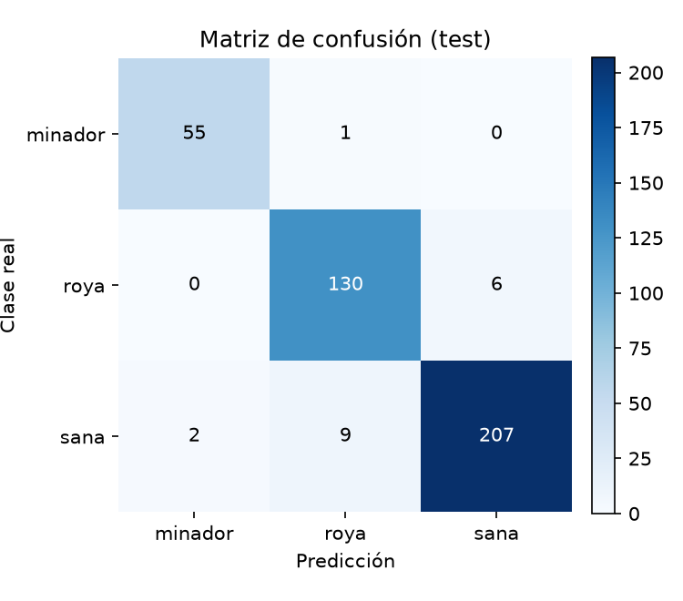

# Resultados

Archivo generado por `ml/generar_resultados.py` a partir de `ml/outputs/`. No editar a mano.

Modelo `v1-2026-10`: MobileNetV2 con clases minador, roya, sana.

## Datos

| Clase | train | val | test | Total |
|---|---|---|---|---|
| minador | 260 | 56 | 56 | 372 |
| roya | 636 | 136 | 136 | 908 |
| sana | 1019 | 219 | 218 | 1456 |

Total: 2736 imágenes. Desbalance en entrenamiento (clase mayor / menor): 3.919. Duplicados eliminados: 535. Imágenes en dos particiones: 0 por MD5, 0 pares por hash perceptual y 0 grupos repartidos.

## Entrenamiento

Hardware: Tesla T4. Tiempo: 1038.2 s. Épocas ejecutadas: 15 (cabeza) + 10 (ajuste fino). TensorFlow 2.21.0, Keras 3.15.1, Python 3.13.15. Pérdida de validación: 0.6714 en la época 1, mínimo 0.1590.

## Métricas en test (410 imágenes)

Exactitud: 0.9561. **F1 macro: 0.9587**.

| Clase | Precisión | Recall | F1 | Imágenes |
|---|---|---|---|---|
| minador | 0.9649 | 0.9821 | 0.9735 | 56 |
| roya | 0.9286 | 0.9559 | 0.942 | 136 |
| sana | 0.9718 | 0.9495 | 0.9606 | 218 |

### Matriz de confusión

Filas: clase real. Columnas: predicción.

|  | minador | roya | sana |
|---|---|---|---|
| minador | 55 | 1 | 0 |
| roya | 0 | 130 | 6 |
| sana | 2 | 9 | 207 |

## Umbral de confianza: cobertura frente a exactitud

Umbral elegido en validación: **0.4** (regla: menor umbral con exactitud aceptada ≥ 0.9). Exactitud en validación sin umbral: 0.9513.

| Umbral | Aceptadas | Fracción aceptada | Exactitud en aceptadas |
|---|---|---|---|
| 0.4 | 411 | 1.0 | 0.9513 |
| 0.45 | 411 | 1.0 | 0.9513 |
| 0.5 | 409 | 0.9951 | 0.9511 |
| 0.55 | 403 | 0.9805 | 0.9553 |
| 0.6 | 394 | 0.9586 | 0.9619 |
| 0.65 | 386 | 0.9392 | 0.9715 |
| 0.7 | 379 | 0.9221 | 0.9763 |
| 0.75 | 364 | 0.8856 | 0.978 |
| 0.8 | 355 | 0.8637 | 0.9803 |
| 0.85 | 340 | 0.8273 | 0.9794 |
| 0.9 | 319 | 0.7762 | 0.9843 |
| 0.95 | 267 | 0.6496 | 0.9925 |

En test, con el umbral elegido: se acepta 100.0% de las imágenes, con exactitud 0.9561.

## Modelo y paridad

| Archivo | Bytes | Entrada | Salida |
|---|---|---|---|
| model_fp32.tflite | 8901272 | [1, 224, 224, 3] float32 | [1, 3] float32 |
| model.tflite | 2531920 | [1, 224, 224, 3] float32 | [1, 3] float32 |

La app lleva `model_fp32.tflite` (copiado a `assets/model.tflite`).

| Comparación (100 imágenes de test) | Coincidencia de clase | Diferencia máx. de probabilidad |
|---|---|---|
| keras vs fp32 | 1.0 | 0.002211 |
| keras vs quantized | 0.98 | 0.145258 |
| fp32 vs quantized | 0.98 | 0.143047 |

## Android (emulador, no es un teléfono)

Dispositivo: Google sdk_gphone64_x86_64, Android 17, x86_64.

- Paridad nivel 1 (modelo aislado): diferencia máxima de probabilidad 0.0000017 (límite 0.01).

- Paridad nivel 2 (flujo completo): 10 de 10 clases coinciden.

- Latencia con 4 hilos (50 medidas): mediana 9.0 ms, p95 11 ms.

- Comparación de hilos: 2 hilos, mediana 9.0 ms y p95 11 ms; 4 hilos, mediana 12.0 ms y p95 15 ms.

## Android (teléfono)

Dispositivo: motorola motorola edge 30, Android 14, arm64-v8a.

- Paridad nivel 1 (modelo aislado): diferencia máxima de probabilidad 0.0000001 (límite 0.01).

- Paridad nivel 2 (flujo completo): 10 de 10 clases coinciden.

- Latencia con 4 hilos (50 medidas): mediana 21.0 ms, p95 22 ms.

- Comparación de hilos: 2 hilos, mediana 21.0 ms y p95 23 ms; 4 hilos, mediana 21.0 ms y p95 22 ms.

## Resultados en campo

NO EJECUTADO. Falta instalar el APK en un teléfono y probar con fotos reales tomadas por el humano (fase 12). Registrar los casos en `docs/campo.csv` y volver a ejecutar `make results`.

## Limitaciones

- Las métricas se midieron con imágenes de los mismos datasets usados para entrenar (RoCoLe y DECAFIA); no miden el rendimiento con fotos nuevas.
- Posible fuga entre particiones que el hash no detecta: recortes de lesión que pueden provenir de fotos de otra partición y varias tomas de una misma hoja en la clase sana. Tiende a inflar las métricas.
- Casi todas las imágenes de minador son hojas sobre fondo blanco y casi todas las sanas son de campo: el modelo puede apoyarse en el fondo.
- El modelo solo conoce hojas. Una imagen que no es una hoja recibe igualmente una clase con confianza alta; en el emulador, una sala se clasificó como hoja sana.
- Con el umbral elegido se aceptan todas las imágenes de validación y de test, así que en la práctica no filtra.
- Cambio de dominio: RoCoLe es café Robusta de Ecuador y parte de DECAFIA proviene de Brasil; en Colombia predomina el arábica.
- La clase minador tiene pocas imágenes de test, por lo que sus métricas son poco precisas.
- Es un prototipo académico de apoyo, no una herramienta de diagnóstico.
