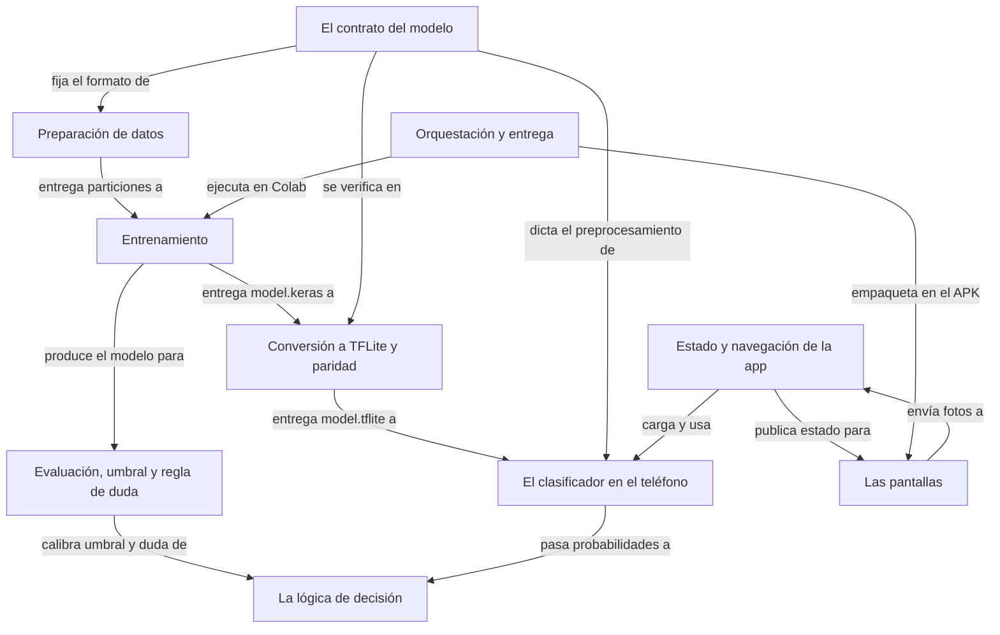

# BioCafe — Tutorial del código

BioCafe es un prototipo académico (Universidad de Pamplona, FCPD 2026-2) que clasifica la foto de una hoja de café en arana_roja, minador, roya o sana directamente en un teléfono Android, sin internet. No es una herramienta de diagnóstico. Piénselo como una cadena de dos talleres unidos por un plano común: en el taller de Python (ml/) se reúnen y limpian las fotos de varias fuentes públicas, se entrena una red EfficientNet-B0 en Google Colab, se examina con imágenes que nunca vio, se convierte a TensorFlow Lite y se comprueba que la traducción sea fiel; en el taller de Kotlin (android/) la app recibe la foto, la prepara exactamente como lo pide el contrato del modelo, ejecuta la inferencia con LiteRT y decide si afirma una clase, advierte una duda o reconoce que no está segura. Una página Next.js ofrece el APK para descargar.

> Este tutorial está orientado al código: cita archivos reales y fragmentos cortos. Para una explicación sin código del mismo recorrido, vea `docs/COMO_SE_CONSTRUYO.md`. Las cifras citadas salen de `docs/resultados.md`, `docs/decisiones.md` y `ml/outputs/final/*.json`.

## La arquitectura de un vistazo

## Capítulos

1. [El contrato del modelo](01_contrato_del_modelo.md) — el acuerdo de entrada, salida y orden de clases que une Python y Kotlin.
2. [Preparación de datos](02_preparacion_de_datos.md) — tres fuentes, duplicados fuera y un reparto 70/15/15 sin fugas.
3. [Entrenamiento](03_entrenamiento.md) — EfficientNet-B0 con transfer learning en dos etapas, en Colab.
4. [Evaluación, umbral y regla de duda](04_evaluacion_umbral_y_duda.md) — test interno, fuente no vista, conjunto final JMuBEN, umbral 0.60 y regla de duda.
5. [Conversión a TFLite y paridad](05_conversion_y_paridad.md) — de Keras a TFLite, por qué fp32 y cómo se prueba la fidelidad en dos niveles.
6. [El clasificador en el teléfono](06_clasificador_en_el_telefono.md) — ImageUtils y CoffeeLeafClassifier: de la foto a cuatro probabilidades.
7. [La lógica de decisión](07_logica_de_decision.md) — buildResult: aceptar, dudar o reconocer incertidumbre.
8. [Estado y navegación de la app](08_estado_y_navegacion.md) — ClassifierViewModel, corrutinas, estado y NavHost.
9. [Las pantallas](09_las_pantallas.md) — inicio, cámara con CameraX y resultado con su ficha y su aviso.
10. [Orquestación y entrega](10_orquestacion_y_entrega.md) — Makefile, Colab, informe generado, APK firmado y página de descarga.

## Glosario

¿Un término no le resulta familiar? Consulte el [Glosario](glosario.md): definiciones breves, en orden alfabético, con el capítulo donde aparece cada término.

---
_Generado en modo de solo lectura a partir del código fuente. Ningún código salió de esta máquina._
