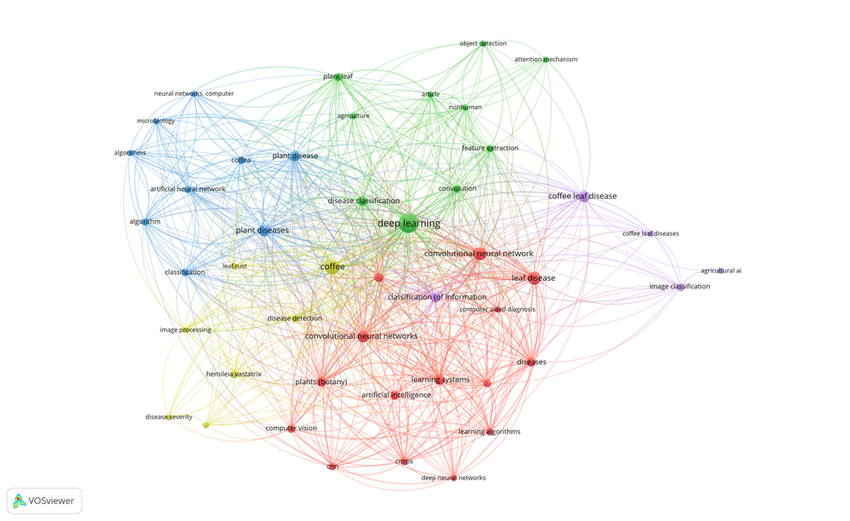
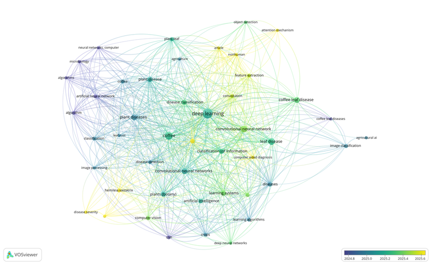
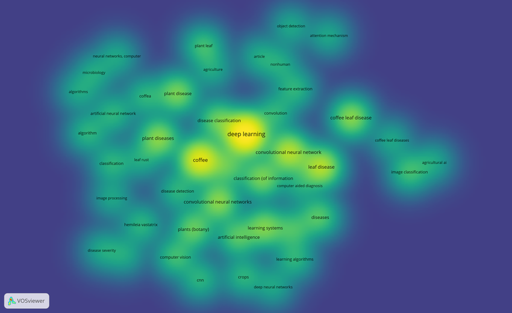

Detección temprana de plagas y enfermedades del café con sistemas
inteligentes y computación paralela y distribuida: una revisión
sistemática descriptiva

Heyley Yurani Parada Parada · C.C. 1093887319

[[heyley.paradapar@unipamplona.edu.co]{.underline}](mailto:heyley.paradapar@unipamplona.edu.co)

Lisbeth Gissel Cordero Tovar · C.C. 1093293375

[[lisbeth.corderotov@unipamplona.edu.co]{.underline}](mailto:lisbeth.corderotov@unipamplona.edu.co)

*Programa de Ingeniería de Sistemas, Facultad de Ingenierías y
Arquitectura*

*Universidad de Pamplona, Villa del Rosario, Norte de Santander,
Colombia*

***Resumen---*La roya y el minador reducen la productividad del café, y
su monitoreo en las fincas sigue siendo mayoritariamente visual. Este
artículo presenta una revisión sistemática descriptiva de la literatura
relacionada con el proyecto «Sistema de detección temprana de plagas y
enfermedades en cultivos de café», cuyo prototipo, BioCafe, clasifica
fotos de hojas en el teléfono. A partir de ocho constructos del
proyecto, que abarcan el problema agrícola, los sistemas inteligentes y
la computación paralela y distribuida, se formularon prompts y cadenas
de búsqueda que se ejecutaron en Crossref el 27 de octubre de 2026 y en
Scopus el 31 de octubre de 2026, limitadas a artículos de revista
publicados desde 2022 y con prioridad para ScienceDirect. Se incluyeron
50 artículos con DOI verificado, 16 de ellos de ScienceDirect y 34 de
otras bases. La literatura muestra que las redes neuronales
convolucionales clasifican enfermedades de la hoja de café con
exactitudes de 90,84 % a 99,95 % en conjuntos controlados, pero pierden
desempeño con imágenes de campo; que las imágenes multiespectrales
permiten detectar la roya antes de los síntomas; que los modelos ligeros
funcionan sin conexión en teléfonos y microcontroladores, y que el
entrenamiento en GPU y el entrenamiento distribuido reducen el costo de
reentrenar. El análisis bibliométrico muestra tres grupos temáticos:
modelos CNN, café y roya, y agricultura de precisión. Se concluye que
las decisiones de BioCafe coinciden con la literatura y que su principal
vacío es la validación con fotos de fincas colombianas.**

***Palabras clave---*detección temprana, roya del café, minador del
café, redes neuronales convolucionales, aprendizaje por transferencia,
computación en el borde, entrenamiento distribuido, sistemas
inteligentes.**

***Abstract---*Coffee leaf rust and leaf miner reduce coffee
productivity, and on-farm monitoring is still mostly visual. This paper
presents a descriptive systematic review of the literature related to
the project \"Early detection system for pests and diseases in coffee
crops\", whose prototype, BioCafe, classifies leaf photos on the phone.
Eight constructs of the project, covering the agricultural problem,
intelligent systems and parallel and distributed computing, were turned
into prompts and search strings that were run on Crossref on October 27,
2026 and in Scopus on October 31, 2026, restricted to journal articles
published since 2022 and giving priority to ScienceDirect. Fifty articles
with a verified DOI were included, 16 of them from ScienceDirect and 34
from other sources. The literature shows that convolutional neural
networks classify coffee leaf diseases with accuracies from 90.84% to
99.95% on controlled datasets but lose performance on field images; that
multispectral imaging detects rust before symptoms appear; that
lightweight models run offline on phones and microcontrollers; and that
GPU and distributed training lower the cost of retraining. The
bibliometric analysis shows three thematic clusters: CNN models, coffee
and leaf rust, and precision agriculture. BioCafe\\'s design choices agree
with the literature, and its main gap is validation with photos from
Colombian farms.**

***Index Terms---*early detection, coffee leaf rust, coffee leaf miner,
convolutional neural networks, transfer learning, edge computing,
distributed training, intelligent systems.**

[I. Introducción]{.smallcaps}

La roya del café, causada por el hongo Hemileia vastatrix, es la
enfermedad más dañina del cultivo en el mundo: reduce los rendimientos y
puede causar la muerte de la planta \[1\]. En Etiopía, centro de origen
del café arábica, su incidencia media llegó a 35,3 % y se extendió a
zonas altas donde antes no se presentaba \[2\]. El minador de la hoja
(Leucoptera coffeella) es la principal plaga de insectos en varios
países productores y se controla sobre todo con insecticidas sistémicos
\[3\]. Aun así, una revisión de 51 estudios encontró que el monitoreo de
estas afectaciones sigue dependiendo de la observación visual y de
trampas, y que tecnologías como sensores, drones, IoT e inteligencia
artificial se usan poco en los cafetales \[4\].

El proyecto «Sistema de detección temprana de plagas y enfermedades en
cultivos de café», de la Universidad de Pamplona, busca cerrar esa
brecha. Su prototipo, BioCafe, es una aplicación Android que clasifica
una foto de una hoja en cuatro clases (sana, roya, minador y arañita
roja) con una red EfficientNet-B0 que se ejecuta en el teléfono, sin
conexión. La red se entrenó en una GPU de Google Colab con 3736 imágenes
de tres conjuntos públicos. Según el repositorio del proyecto, alcanza
una exactitud de 0,94 en la prueba interna y de 0,81 en un conjunto
externo, y tarda 48 ms por imagen en un teléfono Android.

El proyecto combina dos áreas de formación. Desde los Sistemas
Inteligentes, usa visión por computador y aprendizaje profundo para
reconocer la afectación. Desde los Fundamentos de Computación Paralela y
Distribuida, depende de la GPU para entrenar y de la ejecución
distribuida entre la nube, donde se entrena, y el dispositivo, donde se
diagnostica. Una revisión de la literatura reciente permite contrastar
estas decisiones con lo que se ha publicado y ubicar lo que falta.

El objetivo de esta revisión es describir el estado del conocimiento
publicado desde 2022 sobre los componentes del proyecto y relacionarlo
con BioCafe. Se plantean tres preguntas descriptivas: (PR1) ¿qué
afectaciones foliares del café y qué formas de detectarlas temprano
describe la literatura reciente?; (PR2) ¿qué datos y modelos de sistemas
inteligentes se usan para clasificarlas y cómo se comportan en
condiciones de campo?, y (PR3) ¿qué aporta la computación paralela y
distribuida al entrenamiento y al despliegue de estos sistemas? PR1 se
responde con los constructos C1 y C2; PR2, con C3 a C5, y PR3, con C6 a
C8. La sección II describe el método; la sección III presenta y discute
los resultados, y la sección IV resume las conclusiones.

[II. Materiales y métodos]{.smallcaps}

*A. Tipo de revisión*

Se realizó una revisión sistemática de tipo descriptivo: su propósito es
poner al día al lector sobre lo que se sabe de un tema en evolución, no
responder una pregunta causal ni combinar resultados con metaanálisis.
Se siguieron las cuatro etapas de la guía del curso: definir los
objetivos, buscar la bibliografía con una estrategia documentada,
organizar la información y redactar el informe.

*B. Constructos*

Los constructos se derivaron del título y de los componentes del
proyecto: el problema agrícola (las afectaciones y su detección
temprana), el sistema inteligente (datos, modelo y generalización) y la
computación paralela y distribuida (entrenamiento en GPU, inferencia en
el dispositivo y arquitecturas distribuidas). Se definieron ocho
constructos, cada uno con una definición operativa e indicadores (Tabla
I).

[Tabla I]{.smallcaps}

[Constructos de la revisión y artículos incluidos]{.smallcaps}

  -------------------------------------------------------
   **ID**  **Constructo**    **Área**   **Referencias**
  -------- ----------------- ---------- -----------------
     C1    Plagas y          Dom.       \[1\], \[2\],
           enfermedades                 \[3\], \[4\],
           foliares del café            \[14\]

     C2    Detección         SI         \[5\], \[15\],
           temprana y                   \[16\], \[17\]
           diagnóstico                  
           automatizado                 

     C3    Conjuntos de      SI         \[18\], \[19\]
           datos de imágenes            
           de hojas de café             

     C4    Clasificación con SI         \[6\], \[7\],
           redes neuronales             \[8\], \[20\],
           convolucionales y            \[21\], \[22\]
           aprendizaje por              
           transferencia                

     C5    Generalización y  SI         \[9\], \[10\],
           validación en                \[23\], \[24\]
           condiciones de               
           campo                        

     C6    Entrenamiento     PyD        \[11\], \[25\],
           acelerado con GPU            \[26\], \[27\]
           y computación                
           paralela                     

     C7    Inferencia en el  SI + PyD   \[12\], \[13\],
           dispositivo móvil            \[28\], \[30\]
           y en el borde                

     C8    Sistemas          PyD        \[29\], \[31\],
           distribuidos, IoT            \[32\]
           y aprendizaje                
           federado en                  
           agricultura                  
  -------------------------------------------------------

Dom.: dominio del proyecto. SI: Sistemas Inteligentes. PyD: Computación
Paralela y Distribuida.

*C. Estrategia de búsqueda*

Para cada constructo se redactó un prompt que expresa el pedido de
referencias y, a partir de él, dos cadenas de búsqueda en inglés. Las
cadenas se ejecutaron el 27 de octubre de 2026 en la API de Crossref,
que indexa ScienceDirect, IEEE, Springer, MDPI y otras editoriales, y el
31 de octubre de 2026 en Scopus con una cadena avanzada que combina
términos de enfermedades foliares del café, visión por computador y
aprendizaje profundo. Cada cadena se lanzó dos veces, una limitada al
prefijo DOI de Elsevier (10.1016, ScienceDirect) y otra sin límite de
editorial, con dos filtros comunes: artículos de revista y fecha de
publicación desde el 1 de enero de 2022. Se revisaron los diez primeros
resultados por relevancia de cada una de las 32 búsquedas. Los prompts,
las cadenas exactas, los totales de resultados y los scripts que repiten
el proceso quedaron documentados en el archivo de constructos y prompts
que acompaña este artículo.

*D. Criterios de selección*

Se incluyeron artículos de revista publicados desde 2022, con DOI que
resuelve en Crossref, con resumen recuperable y relacionados
directamente con un constructo; se dio preferencia a ScienceDirect y a
los trabajos sobre café. Se excluyeron el ruido de la búsqueda (por
ejemplo, detección temprana de enfermedades humanas), los trabajos sin
resumen recuperable, los redundantes con otro ya incluido y los que
estaban fuera del alcance de clasificación de imágenes. Mediante el
servidor MCP de Zotero se verificó que ninguno estuviera ya en la
biblioteca de las autoras.

*E. Verificación y extracción*

Cada DOI se consultó en Crossref para confirmar su existencia, autores,
revista y fecha. El resumen se tomó de Crossref, Semantic Scholar u
OpenAlex. De cada artículo se extrajeron el objetivo, el método, el
hallazgo principal con sus cifras y su relación con BioCafe. Las 50
referencias se cargaron en una colección de Zotero y se exportaron como
archivo semilla (RIS y BibTeX) para poder importarlas en cualquier
equipo.

*F. Flujo de selección*

Las 32 búsquedas devolvieron 320 registros revisados, 236 de ellos
únicos. A estos se sumaron cuatro artículos hallados en una primera
búsqueda de la revisión, centrada en MPI, que luego se reorientó al
proyecto. Por título, revista y año se preseleccionaron 63, a los que se
les verificó el DOI. Se excluyeron 10 por no tener resumen recuperable y
3 por redundancia o alcance, y quedaron 50 artículos incluidos (Fig. 1).

*Fig. 1. Flujo de identificación y selección de los estudios.*

[III. Resultados y discusión]{.smallcaps}

*A. Panorama de los estudios incluidos*

De los 50 artículos, 16 tienen DOI de ScienceDirect (Elsevier), 6 son de
MDPI, 4 de IEEE y los 24 restantes de otras editoriales, entre ellas la
Revista Colombiana de Computación. Todos fueron publicados entre 2022 y
2026. Catorce tratan directamente sobre café; los otros treinta y seis
abordan la detección de enfermedades en otros cultivos o la computación
paralela y distribuida que la soporta. La Tabla II reúne los hallazgos
cuantitativos más relevantes para BioCafe.

[Tabla II]{.smallcaps}

[Hallazgos cuantitativos relevantes para BioCafe]{.smallcaps}

  ---------------------------------------
   **Ref.**  **Hallazgo reportado en el
             resumen**
  ---------- ----------------------------
    \[1\]    Roya en Hawái: la incidencia
             pasó de menos de 4 % a 36 %
             en la cosecha pese a 3 a 10
             aplicaciones preventivas

    \[2\]    Roya en Etiopía: incidencia
             media de 35,3 % y expansión
             a zonas altas

    \[5\]    Roya detectada 15 días tras
             la inoculación, antes de los
             síntomas: 80 % de exactitud

    \[6\]    Coffee-Net, cinco clases
             (incluye minador y roya):
             99,95 % de exactitud

    \[7\]    CNN en una placa de bajo
             costo, sin internet:
             exactitud cercana a 98 %

    \[8\]    CoffNet: 97,88 % de
             exactitud a 125,93 imágenes
             por segundo

    \[9\]    Generalización entre
             conjuntos de datos: máximo
             de 81,60 %

    \[10\]   Adaptación de dominio: 56,06
             % en PlantDoc frente a 96,78
             % en otro conjunto

    \[11\]   Elegir la implementación de
             Allreduce acelera el
             entrenamiento de 1,2 a 2,8
             veces

    \[12\]   Cuantización: de 1,5 a 0,93
             millones de parámetros sin
             perder 99,50 % de exactitud

    \[13\]   MobileNetV2, el modelo más
             adecuado para el teléfono
             sin conexión
  ---------------------------------------

*B. Afectaciones foliares del café y su manejo (C1)*

La roya es la afectación más estudiada. En Hawái, donde llegó en 2020,
el monitoreo de 30 lotes mostró una incidencia inferior a 4 % al inicio
de la temporada que subió a 36 % en la cosecha, por encima del umbral de
acción de 5 % aun con 3 a 10 aplicaciones preventivas de fungicida
\[1\]. En ensayos posteriores en las mismas fincas, un fungicida
translaminar mantuvo la roya por debajo de 2 % durante 12 semanas, y los
fungicidas de cobre fueron los más rentables \[14\]. En Etiopía la
incidencia media alcanzó 35,3 % y el cambio climático favorece su
expansión a nuevas altitudes \[2\]. Sobre el minador, Leite et al.
advierten que el uso innecesario de insecticidas sistémicos puede
seleccionar resistencia en la plaga \[3\]. La revisión de
Rodriguez-Gallo et al. concluye que el manejo de estas afectaciones
sigue apoyado en técnicas tradicionales y que la integración de
sensores, drones, IoT e inteligencia artificial es todavía escasa \[4\].
El conjunto justifica un sistema que detecte a tiempo para aplicar solo
cuando es necesario.

*C. Detección temprana (C2)*

Dos estudios muestran que la detección puede adelantarse a los síntomas.
Soares et al. distinguieron plántulas infectadas de roya a los 15 días
de la inoculación, antes de las lesiones visibles, con imágenes
multiespectrales tomadas desde un dron y una máquina de vectores de
soporte, con 80 % de exactitud \[5\]. Santos et al. diferenciaron hojas
sanas de hojas atacadas por el minador con índices de vegetación
multiespectrales; el NDVI medio fue de 0,64 en hojas sanas y de 0,41 en
hojas infestadas, y el índice GRNDVI fue el que mejor las separó \[15\].
Las revisiones generales coinciden en que el aprendizaje profundo supera
a las técnicas clásicas de aprendizaje automático en la detección de
enfermedades a partir de imágenes \[16\] y en que la falta de datos de
campo etiquetados es el principal obstáculo para llevar estos modelos,
incluidos los basados en biosensores, a la agricultura de precisión
\[17\]. BioCafe trabaja con fotos RGB del teléfono, de modo que detecta
cuando hay síntomas visibles; la detección presintomática exigiría otro
sensor.

*D. Conjuntos de datos de hojas de café (C3)*

Los datos son el insumo crítico. Aroca-Trujillo y Perez-Ruiz publicaron
6726 imágenes multiespectrales de hojas de café de fincas colombianas,
con y sin lesiones de roya, capturadas en RGB y en cinco bandas bajo
iluminación controlada \[18\]. CoLeaf-DB aporta 1006 imágenes de hojas
de café del Perú etiquetadas por agrónomos según deficiencias
nutricionales \[19\]. El primero es directamente aprovechable por
BioCafe para ampliar la clase roya con muestras colombianas; el segundo,
para añadir clases distintas de plagas y enfermedades.

*E. Clasificación con redes convolucionales (C4)*

Los trabajos sobre café reportan exactitudes altas en conjuntos
controlados. Coffee-Net clasifica hojas sanas y con Phoma, minador, roya
y Cercospora con 99,95 % de exactitud \[6\]. CoffNet alcanza 97,88 % a
125,93 imágenes por segundo \[8\]. Bordin Yamashita y Leite clasificaron
seis enfermedades con más de 6000 imágenes y redes ejecutadas en una
placa de bajo costo, sin conexión, con exactitudes cercanas a 98 % y 96
% \[7\]. Araaf et al. detectaron roya con YOLOv8 con un mAP de 73,2 %
\[20\]. Chavarro et al. compararon más de 800 modelos de transferencia
para la roya y hallaron que la arquitectura base es el hiperparámetro de
mayor efecto, con diferencias de hasta 70 % \[21\], y Paymode y Malode
confirman la eficacia del aprendizaje por transferencia en otros
cultivos \[22\]. BioCafe sigue este enfoque: eligió EfficientNet-B0 tras
compararla con MobileNetV2.

*F. Generalización a condiciones de campo (C5)*

Las exactitudes anteriores no se trasladan al campo. Ahmad et al.
mostraron que los modelos entrenados con imágenes de laboratorio no
generalizan con la misma exactitud a otros conjuntos: la mejor
generalización fue de 81,60 %, y eliminar el fondo o mezclar imágenes de
laboratorio y de campo la mejora \[9\]. Con adaptación de dominio no
supervisada, Wu et al. obtuvieron exactitudes de 56,06 % en PlantDoc y
de 96,78 % en otro conjunto, lo que muestra cuánto varía el desempeño
entre fuentes \[10\]. Jeon et al. recomponen el fondo de las imágenes
para acercarlas a las del cultivo y logran un desempeño robusto en campo
sin datos de campo etiquetados \[23\], y Bouacida et al. reconocen hojas
enfermas de cultivos no vistos enfocándose en las regiones lesionadas,
con 97,13 % de exactitud en conjuntos nuevos \[24\]. BioCafe muestra el
mismo fenómeno: pasa de 0,94 en la prueba interna a 0,81 en un conjunto
externo.

*G. Entrenamiento con GPU y computación paralela (C6)*

Entrenar estos modelos es la parte costosa del sistema. Las revisiones
sobre paralelismo distinguen el paralelismo de datos, en el que cada GPU
entrena una copia del modelo con una parte de las imágenes, del
paralelismo de modelo, que reparte el modelo entre dispositivos \[25\],
\[26\]. En un caso de clasificación de imágenes médicas, el paralelismo
de modelo logró una aceleración de 1,38 veces y una exactitud de
validación de 62,13 % frente a 55,72 % \[27\]. Cuando el entrenamiento
se distribuye en un clúster con TensorFlow y Horovod, la operación
colectiva Allreduce de MPI, que suma los gradientes, determina el
rendimiento: elegir bien su implementación acelera el entrenamiento de
redes convolucionales entre 1,2 y 2,8 veces \[11\]. Para BioCafe, que
entrena EfficientNet-B0 en una sola GPU, el paralelismo de datos es la
vía para reentrenar con más imágenes sin alargar el tiempo de
entrenamiento.

*H. Despliegue móvil, en el borde y distribuido (C7 y C8)*

Los modelos ligeros permiten diagnosticar sin conexión.
RTR_Lite_MobileNet logra 90,84 % de exactitud en un conjunto de café y
funciona en Raspberry Pi 4 y 5 con baja latencia y bajo consumo de
memoria \[28\]. Khan et al. redujeron con cuantización los parámetros de
MobileNetV3-small de cerca de 1,5 millones a 0,93 millones sin perder su
exactitud de 99,50 % \[12\]. Nayak et al. compararon modelos para arroz
y encontraron que MobileNetV2 es el más adecuado para una aplicación de
teléfono que funciona sin conexión, mientras que ResNet50 rindió mejor
en la nube; su sistema reentrena el modelo en un servidor con imágenes
nuevas y lo actualiza en el teléfono \[13\]. Otras aplicaciones envían
la foto a un servidor: Cocoa Companion diagnostica en la nube \[29\] y
la de Ramana Reddy et al. usa un servicio web para la inferencia \[30\].
En el extremo distribuido, AGRIFOLD entrena una red ligera entre varios
participantes con aprendizaje federado, sin compartir las imágenes
\[31\], y Ghazal et al. señalan los retos de desplegar modelos generales
de visión en tiempo real en fincas \[32\]. BioCafe adopta el esquema de
Nayak et al.: entrena en la nube y diagnostica en el teléfono.

*I. Implicaciones para BioCafe*

La literatura respalda las decisiones principales del prototipo:
aprendizaje por transferencia con una arquitectura elegida por
comparación \[21\], diagnóstico en el dispositivo sin conexión \[7\],
\[13\] y entrenamiento en GPU. También señala tres mejoras concretas.
Primero, incorporar fotos colombianas, empezando por el conjunto de
Aroca-Trujillo y Perez-Ruiz \[18\], y validar con fotos de fincas de
Norte de Santander. Segundo, aplicar técnicas de generalización como la
recomposición del fondo o la adaptación de dominio \[9\], \[23\].
Tercero, cuando el volumen de datos crezca, distribuir el
reentrenamiento con paralelismo de datos \[11\] y, a más largo plazo,
explorar el aprendizaje federado entre fincas \[31\].

*J. Vacíos y limitaciones*

No se encontraron trabajos sobre la arañita roja en café con visión por
computador, la clase más débil de BioCafe, ni validaciones en fincas
colombianas de modelos entrenados con datos públicos. Los estudios sobre
café reportan exactitudes en conjuntos controlados y rara vez en un
conjunto externo. Esta revisión tiene límites propios: usó una sola base
(Crossref), revisó los diez primeros resultados de cada búsqueda y
excluyó 10 artículos cuyo resumen no estaba disponible en APIs abiertas.

*K. Análisis bibliométrico*

Se analizaron 50 artículos con VOSviewer. La coaparición de palabras
clave arrojó 46 términos con mínimo de 3 apariciones. Los términos más
frecuentes fueron deep learning, coffee, leaf disease, convolutional
neural network y classification, lo que confirma que el núcleo temático
es la clasificación automática de afectaciones foliares. El mapa muestra
tres grupos: modelos CNN y estrategias de clasificación, café y roya
Hemileia vastatrix, y agricultura de precisión y despliegue móvil. No hay
un grupo consolidado alrededor de arañita roja, lo que coincide con el
vacío detectado en la revisión cualitativa.

{width="2.8in"
height="1.7142857142857142in"}

Fig. 2. Coaparición de palabras clave en los 50 artículos incluidos.

La red de coautoría muestra colaboración moderada, con núcleos pequeños
de 2 a 3 artículos y muchos autores con una sola contribución. Esto
indica que el campo todavía está formando equipos estables y que buena
parte del trabajo se hace en grupos locales.

{width="2.8in"
height="1.7142857142857142in"}

Fig. 3. Red de coautoría en los 50 artículos incluidos.

El mapa de términos de títulos y resúmenes refleja la transición de
2024 a 2026: predominan YOLO, EfficientNet, MobileNet, SAM, transfer
learning, active learning y domain adaptation. Para BioCafe, el cierre
es directo: las arquitecturas ligeras y las técnicas de adaptación son
la frontera activa, y el proyecto ya se apoya en esa dirección.

{width="3.2in"
height="2.8778991688538933in"}

Fig. 4. Mapa de términos de títulos y resúmenes en los 50 artículos
incluidos.

[IV. Conclusiones]{.smallcaps}

La revisión identificó 50 artículos recientes, con DOI verificado, que
describen el estado del conocimiento sobre los componentes del proyecto.
Respecto a PR1, la roya y el minador siguen causando pérdidas y su
monitoreo es mayoritariamente visual; las imágenes multiespectrales
permiten detectar la roya antes de los síntomas. Respecto a PR2, las
redes convolucionales con aprendizaje por transferencia clasifican las
enfermedades de la hoja de café con exactitudes de 90,84 % a 99,95 % en
conjuntos controlados, pero su desempeño cae con imágenes de otras
fuentes, un problema que la adaptación de dominio y la mezcla de datos
de campo empiezan a resolver. Respecto a PR3, el entrenamiento en GPU y
el entrenamiento distribuido reducen el costo de reentrenar, los modelos
ligeros y cuantizados permiten diagnosticar sin conexión, y el
aprendizaje federado abre la posibilidad de mejorar el modelo con datos
de varias fincas.

Las decisiones de BioCafe coinciden con lo que reporta la literatura. Su
principal vacío, compartido con la mayoría de los trabajos revisados, es
la validación en campo: se propone como trabajo futuro reentrenar con
fotos colombianas, medir el desempeño en fincas de Norte de Santander y
reforzar la clase arañita roja, para la que no se encontraron estudios
específicos.

[Referencias]{.smallcaps}

\[1\] L. F. Aristizábal and M. A. Johnson, "Monitoring Coffee Leaf Rust
(Hemileia vastatrix) on Commercial Coffee Farms in Hawaii: Early
Insights from the First Year of Disease Incursion," *Agronomy*, vol. 12,
no. 5, p. 1134, 2022, doi:
[[10.3390/agronomy12051134]{.underline}](https://doi.org/10.3390/agronomy12051134).

\[2\] G. Berihun and K. Alemu, "Status of coffee leaf rust ( Hemileia
vastatrix ) and its management in Ethiopia: a review," *Archives of
Phytopathology and Plant Protection*, vol. 55, no. 20, pp. 2283--2300,
2022, doi:
[[10.1080/03235408.2023.2168173]{.underline}](https://doi.org/10.1080/03235408.2023.2168173).

\[3\] S. A. Leite et al., "The effects of thiamethoxam on coffee
seedling morphophysiology and Neotropical leaf miner ( Leucoptera
coffeella ) infestations," *Pest Management Science*, vol. 78, no. 6,
pp. 2581--2587, 2022, doi:
[[10.1002/ps.6889]{.underline}](https://doi.org/10.1002/ps.6889).

\[4\] Y. Rodriguez-Gallo, H. Cañas, J. Cruz, M. Cardona, and G.
Medina-González, "Coffee leaf rust and berry borer management in
agroforestry systems: A systematic literature review," *Smart
Agricultural Technology*, vol. 9, p. 100656, 2024, doi:
[[10.1016/j.atech.2024.100656]{.underline}](https://doi.org/10.1016/j.atech.2024.100656).

\[5\] A. d. S. Soares, B. S. Vieira, T. A. Bezerra, G. D. Martins, and
A. C. S. Siquieroli, "Early Detection of Coffee Leaf Rust Caused by
Hemileia vastatrix Using Multispectral Images," *Agronomy*, vol. 12, no.
12, p. 2911, 2022, doi:
[[10.3390/agronomy12122911]{.underline}](https://doi.org/10.3390/agronomy12122911).

\[6\] P. M. Bidarakundi and B. Muthu Kumar, "Coffee-Net: Deep Mobile
Patch Generation Network for Coffee Leaf Disease Classification," *IEEE
Sensors Journal*, vol. 25, no. 4, pp. 7355--7362, 2025, doi:
[[10.1109/jsen.2024.3498050]{.underline}](https://doi.org/10.1109/jsen.2024.3498050).

\[7\] J. V. Y. Bordin Yamashita and J. P. R. R. Leite, "Coffee disease
classification at the edge using deep learning," *Smart Agricultural
Technology*, vol. 4, p. 100183, 2023, doi:
[[10.1016/j.atech.2023.100183]{.underline}](https://doi.org/10.1016/j.atech.2023.100183).

\[8\] O. Adelaja and B. Pranggono, "Leveraging Deep Learning for
Real-Time Coffee Leaf Disease Identification," *AgriEngineering*, vol.
7, no. 1, p. 13, 2025, doi:
[[10.3390/agriengineering7010013]{.underline}](https://doi.org/10.3390/agriengineering7010013).

\[9\] A. Ahmad, A. E. Gamal, and D. Saraswat, "Toward Generalization of
Deep Learning-Based Plant Disease Identification Under Controlled and
Field Conditions," *IEEE Access*, vol. 11, pp. 9042--9057, 2023, doi:
[[10.1109/access.2023.3240100]{.underline}](https://doi.org/10.1109/access.2023.3240100).

\[10\] X. Wu, X. Fan, P. Luo, S. D. Choudhury, T. Tjahjadi, and C. Hu,
"From Laboratory to Field: Unsupervised Domain Adaptation for Plant
Disease Recognition in the Wild," *Plant Phenomics*, vol. 5, p. 0038,
2023, doi:
[[10.34133/plantphenomics.0038]{.underline}](https://doi.org/10.34133/plantphenomics.0038).

\[11\] A. Castelló, M. Catalán, M. F. Dolz, E. S. Quintana-Ortí, and J.
Duato, "Analyzing the impact of the MPI allreduce in distributed
training of convolutional neural networks," *Computing*, vol. 105, no.
5, pp. 1101--1119, 2023, doi:
[[10.1007/s00607-021-01029-2]{.underline}](https://doi.org/10.1007/s00607-021-01029-2).

\[12\] A. T. Khan, S. M. Jensen, A. R. Khan, and S. Li, "Plant disease
detection model for edge computing devices," *Frontiers in Plant
Science*, vol. 14, Art. no. 1308528, 2023, doi:
[[10.3389/fpls.2023.1308528]{.underline}](https://doi.org/10.3389/fpls.2023.1308528).

\[13\] A. Nayak, S. Chakraborty, and D. K. Swain, "Application of
smartphone-image processing and transfer learning for rice disease and
nutrient deficiency detection," *Smart Agricultural Technology*, vol. 4,
p. 100195, 2023, doi:
[[10.1016/j.atech.2023.100195]{.underline}](https://doi.org/10.1016/j.atech.2023.100195).

\[14\] L. F. Aristizábal, C. T. Maeda, T. Matsumoto, and M. A. Johnson,
"Fungicide efficacy and duration of protection against coffee leaf rust
(Hemileia vastatrix) on commercial coffee farms in Hawaii," *Crop
Protection*, vol. 196, p. 107269, 2025, doi:
[[10.1016/j.cropro.2025.107269]{.underline}](https://doi.org/10.1016/j.cropro.2025.107269).

\[15\] L. M. d. Santos et al., "Vegetation Indices Applied to Suborbital
Multispectral Images of Healthy Coffee and Coffee Infested with Coffee
Leaf Miner," *AgriEngineering*, vol. 4, no. 1, pp. 311--319, 2022, doi:
[[10.3390/agriengineering4010021]{.underline}](https://doi.org/10.3390/agriengineering4010021).

\[16\] C. Jackulin and S. Murugavalli, "A comprehensive review on
detection of plant disease using machine learning and deep learning
approaches," *Measurement: Sensors*, vol. 24, p. 100441, 2022, doi:
[[10.1016/j.measen.2022.100441]{.underline}](https://doi.org/10.1016/j.measen.2022.100441).

\[17\] A. Sharma, M. M. Sharma, and H. Priyadarshi, "Machine
learning-integrated plant biosensors for precision agriculture: A
systematic review of stress detection, pathogen monitoring and smart
crop management," *Sensors and Actuators Reports*, vol. 12, p. 100502,
2026, doi:
[[10.1016/j.snr.2026.100502]{.underline}](https://doi.org/10.1016/j.snr.2026.100502).

\[18\] J. L. Aroca-Trujillo and A. Perez-Ruiz, "Colombian coffee tree
leaves multispectral images dataset," *Data in Brief*, vol. 59, p.
111421, 2025, doi:
[[10.1016/j.dib.2025.111421]{.underline}](https://doi.org/10.1016/j.dib.2025.111421).

\[19\] V. A. Tuesta-Monteza, H. I. Mejia-Cabrera, and J. Arcila-Diaz,
"CoLeaf-DB: Peruvian coffee leaf images dataset for coffee leaf
nutritional deficiencies detection and classification," *Data in Brief*,
vol. 48, p. 109226, 2023, doi:
[[10.1016/j.dib.2023.109226]{.underline}](https://doi.org/10.1016/j.dib.2023.109226).

\[20\] R. T. Araaf, A. Minn, and T. Ahamed, "Coffee Leaf Rust Disease
Detection and Implementation of an Edge Device for Pruning Infected
Leaves via Deep Learning Algorithms," *Sensors*, vol. 24, no. 24, p.
8018, 2024, doi:
[[10.3390/s24248018]{.underline}](https://doi.org/10.3390/s24248018).

\[21\] A. F. Chavarro, D. Renza, and D. M. Ballesteros, "Influence of
Hyperparameters in Deep Learning Models for Coffee Rust Detection,"
*Applied Sciences*, vol. 13, no. 7, p. 4565, 2023, doi:
[[10.3390/app13074565]{.underline}](https://doi.org/10.3390/app13074565).

\[22\] A. S. Paymode and V. B. Malode, "Transfer Learning for Multi-Crop
Leaf Disease Image Classification using Convolutional Neural Network
VGG," *Artificial Intelligence in Agriculture*, vol. 6, pp. 23--33,
2022, doi:
[[10.1016/j.aiia.2021.12.002]{.underline}](https://doi.org/10.1016/j.aiia.2021.12.002).

\[23\] W. Jeon, T. Kim, S. Choi, K. Yang, S.-Y. Kim, and M. Song,
"Bridging the Lab-to-Field gap in plant disease diagnosis through
unsupervised domain adaptation enhanced by background recomposition,"
*Ecological Informatics*, vol. 93, p. 103579, 2026, doi:
[[10.1016/j.ecoinf.2025.103579]{.underline}](https://doi.org/10.1016/j.ecoinf.2025.103579).

\[24\] I. Bouacida, B. Farou, L. Djakhdjakha, H. Seridi, and M. Kurulay,
"Innovative deep learning approach for cross-crop plant disease
detection: A generalized method for identifying unhealthy leaves,"
*Information Processing in Agriculture*, vol. 12, no. 1, pp. 54--67,
2025, doi:
[[10.1016/j.inpa.2024.03.002]{.underline}](https://doi.org/10.1016/j.inpa.2024.03.002).

\[25\] H. Romero-Sandí, G. Núñez, and E. Rojas, "A snapshot of
parallelism in distributed deep learning training," *Revista Colombiana
de Computación*, vol. 25, no. 1, pp. 60--73, 2024, doi:
[[10.29375/25392115.5054]{.underline}](https://doi.org/10.29375/25392115.5054).

\[26\] P. Liang et al., "A Survey on Auto-Parallelism of Large-Scale
Deep Learning Training," *IEEE Transactions on Parallel and Distributed
Systems*, vol. 34, no. 8, pp. 2377--2390, 2023, doi:
[[10.1109/tpds.2023.3281931]{.underline}](https://doi.org/10.1109/tpds.2023.3281931).

\[27\] M. S. Patil and S. Chickerur, "Study of Data and Model
parallelism in Distributed Deep learning for Diabetic retinopathy
classification," *Procedia Computer Science*, vol. 218, pp. 2253--2263,
2023, doi:
[[10.1016/j.procs.2023.01.201]{.underline}](https://doi.org/10.1016/j.procs.2023.01.201).

\[28\] S. Duhan, P. Gulia, N. S. Gill, and E. Narwal,
"RTR_Lite_MobileNetV2: A lightweight and efficient model for plant
disease detection and classification," *Current Plant Biology*, vol. 42,
p. 100459, 2025, doi:
[[10.1016/j.cpb.2025.100459]{.underline}](https://doi.org/10.1016/j.cpb.2025.100459).

\[29\] S. Kumi, D. Kelly, J. Woodstuff, R. K. Lomotey, R. Orji, and R.
Deters, "Cocoa Companion: Deep Learning-Based Smartphone Application for
Cocoa Disease Detection," *Procedia Computer Science*, vol. 203, pp.
87--94, 2022, doi:
[[10.1016/j.procs.2022.07.013]{.underline}](https://doi.org/10.1016/j.procs.2022.07.013).

\[30\] B. Ramana Reddy, G. Kalnoor, M. Devashish, and P. Sai Karthik
Reddy, "Deep Learning Based Mobile Application for Automated Plant
Disease Detection," *IEEE Access*, vol. 13, pp. 107917--107925, 2025,
doi:
[[10.1109/access.2025.3581099]{.underline}](https://doi.org/10.1109/access.2025.3581099).

\[31\] F. Piccialli, C. Della Bruna, D. Chiaro, P. Qi, and M. Savoia,
"AGRIFOLD: AGRIculture Federated learning for Optimized Leaf disease
Detection," *Expert Systems with Applications*, vol. 289, p. 128371,
2025, doi:
[[10.1016/j.eswa.2025.128371]{.underline}](https://doi.org/10.1016/j.eswa.2025.128371).

\[32\] S. Ghazal, A. Munir, and W. S. Qureshi, "Computer vision in smart
agriculture and precision farming: Techniques and applications,"
*Artificial Intelligence in Agriculture*, vol. 13, pp. 64--83, 2024,
doi:
[[10.1016/j.aiia.2024.06.004]{.underline}](https://doi.org/10.1016/j.aiia.2024.06.004).
